# تصميم قاعدة بيانات مِحوَر

**الحالة:** وثيقة التصميم مع ترحيل أولي غير مطبق في [`supabase/migrations/20261120210000_mihwar_core.sql`](./supabase/migrations/20261120210000_mihwar_core.sql). أضيفت حالات pgTAP في [`supabase/tests/mihwar_rls.test.sql`](./supabase/tests/mihwar_rls.test.sql)، لكنها لم تُشغّل لغياب بيئة PostgreSQL؛ لا تعتبر الجداول أو السياسات متاحة في بيئة تشغيل إلى أن يُطبق الترحيل وتنجح اختبارات قاعدة البيانات والعزل.

## مبادئ النموذج

1. PostgreSQL قاعدة واحدة لكل بيئة، مقسمة إلى نطاقات وظيفية بكيانات واضحة؛ لا قاعدة منفصلة لكل وحدة ولا جدول أعمال عام بصيغة JSON.
2. يملك مِحوَر جدول principal داخلياً؛ يربط `sarh_identity_links` زوج `(issuer, subject)` موثقاً بهوية مِحوَر ثابتة. لا يُنسخ `auth.users` من صَرح ولا تُقبل الهوية من جسم الطلب. يجب أن يثبت حد الهوية claim موثوقاً تستطيع RLS التحقق منه قبل إتاحة أي بيانات.
3. لكل كيان مستخدم معرف UUID و`UNIQUE (owner_id,id)` كي تستخدم العلاقات مفاتيح أجنبية مركبة تمنع الربط بين مالكين. جداول الروابط ومفاتيح idempotency تستخدم مفتاحاً مركباً دون عمود `id` مصطنع؛ جدول التفضيلات مفتاحه `owner_id`. `owner_id` ثابت لا يغيّره العميل.
4. تُستخدم UUIDs للمعرفات. الأوقات الفعلية `timestamptz`، والمواعيد المدنية المتكررة `date` + `time` + منطقة IANA. العملات ISO 4217 وحساب المال `numeric(14,2)`؛ يمنع `float`.
5. لا ينسخ الخط الزمني أو التقرير بيانات الكيان المصدر. يحتفظ كل صف بعمره وإصداره وسجل حياته الخاص.
6. الحذف الافتراضي أرشفة/حذف منطقي قابل للاسترجاع؛ الحذف النهائي وسياسة المدة ما زالا قراراً مطلوباً. لا تنفذ cascade للملفات أو الروابط قبل عملية حذف مدروسة.

## مخطط ERD

```mermaid
erDiagram
  MIHWAR_USERS ||--|| USER_PREFERENCES : owns
  MIHWAR_USERS ||--o{ SARH_IDENTITY_LINKS : maps
  MIHWAR_USERS ||--o{ JOURNEYS : owns
  JOURNEYS ||--o{ LOCATIONS : owns
  JOURNEYS ||--o{ PATHS : owns
  JOURNEYS ||--o{ STATIONS : owns
  JOURNEYS ||--o{ TASKS : owns
  PATHS }o--o{ TASKS : task_path_links
  STATIONS o|--o{ TASKS : groups
  TASKS ||--o{ TASK_OCCURRENCES : schedules
  TASKS ||--o{ TASK_SUBTASKS : contains
  JOURNEYS ||--o{ HABITS : owns
  HABITS ||--o{ HABIT_REVISIONS : has_history
  HABITS ||--o{ HABIT_RECORDS : records
  JOURNEYS ||--o{ CALENDAR_EVENTS : owns
  MIHWAR_USERS ||--o{ GOALS : owns
  MIHWAR_USERS ||--o{ PROJECTS : owns
  PROJECTS ||--o{ PROJECT_MILESTONES : has
  GOALS }o--o{ PROJECTS : goal_project_links
  GOALS }o--o{ TASKS : goal_task_links
  GOALS }o--o{ HABITS : goal_habit_links
  GOALS }o--o{ NOTES : note_goal_links
  TASKS }o--o{ NOTES : note_task_links
  PROJECTS }o--o{ NOTES : note_project_links
  JOURNEYS ||--o{ DAILY_REFLECTIONS : records
  JOURNEYS ||--o{ PRAYER_RECORDS : records
  JOURNEYS ||--o{ STUDY_COURSES : owns
  STUDY_COURSES ||--o{ STUDY_LESSONS : contains
  STUDY_LESSONS o|--o{ STUDY_SESSIONS : studies
  JOURNEYS ||--o{ ACTIVITY_SESSIONS : records
  JOURNEYS ||--o{ SLEEP_RECORDS : records
  JOURNEYS ||--o{ MEAL_LOGS : records
  MIHWAR_USERS ||--o{ SHOPPING_LISTS : owns
  SHOPPING_LISTS ||--o{ SHOPPING_ITEMS : contains
  MIHWAR_USERS ||--o{ SUBSCRIPTIONS : owns
  SUBSCRIPTIONS ||--o{ SUBSCRIPTION_OCCURRENCES : schedules
  MIHWAR_USERS ||--o{ FINANCIAL_ACCOUNTS : owns
  FINANCIAL_ACCOUNTS ||--o{ FINANCIAL_TRANSACTIONS : records
  MIHWAR_USERS ||--o{ BUDGETS : configures
  BUDGETS ||--o{ BUDGET_CATEGORY_LIMITS : limits
  FINANCE_CATEGORIES ||--o{ BUDGET_CATEGORY_LIMITS : categorizes
  SHOPPING_ITEMS o|--o| FINANCIAL_TRANSACTIONS : explicitly_links_actual_purchase
  SUBSCRIPTION_OCCURRENCES o|--o| FINANCIAL_TRANSACTIONS : explicitly_links_actual_payment
  MIHWAR_USERS ||--o{ NOTES : owns
  MIHWAR_USERS ||--o{ ATTACHMENTS : owns
  NOTES }o--o{ ATTACHMENTS : attachment_links
  MIHWAR_USERS ||--o{ REMINDER_RULES : configures
  MIHWAR_USERS ||--o{ AUDIT_EVENTS : owns
  MIHWAR_USERS ||--o{ IDEMPOTENCY_KEYS : owns
```

الرسومات مختصرة؛ كل علاقة فعلية بين كيانات مستخدمين يجب أن تحتوي مفتاح المالك المركب، حتى لو لم يظهر في الرسم.

## قاموس الجداول

### الهوية والرحلة والإعدادات

| الجدول | الحقول الجوهرية المقترحة | المفاتيح والقيود |
|---|---|---|
| `mihwer_users` | `id`, `status`, `created_at`, `updated_at`, `deleted_at?` | principal داخلي UUID؛ ينشأ/يعطل فقط عبر مسار موثوق؛ لا يحتوي كلمة مرور أو بيانات دخول |
| `sarh_identity_links` | `owner_id`, `issuer`, `subject`, `linked_at`, `revoked_at?` | PK `(issuer,subject)`؛ FK إلى `mihwer_users`; كتابة مخولة للخادم فقط؛ لا بريد كمعرف ربط ولا وصول عام |
| `user_preferences` | `owner_id`, `locale`, `time_zone`, `week_starts_on`, إعداد التقويم وطريقة الصلاة/العصر، `prayer_recording_consent_at?`, `version`, `updated_at` | PK/FK `owner_id → mihwer_users.id`; فحص منطقة IANA في طبقة موثوقة وتحقق كود التطبيق؛ لا تخزن token؛ لا يسمح بإنشاء سجل صلاة دون موافقة صريحة سارية |
| `journeys` | `id`, `owner_id`, `title`, `time_zone`, `status`, `created_at`, `updated_at`, `version`, `deleted_at` | فهرس فريد جزئي لرحلة نشطة واحدة لكل مستخدم إن وافق المنتج؛ `UNIQUE(owner_id,id)` |
| `locations` | `id`, `owner_id`, `journey_id`, `label`, `latitude`, `longitude`, `time_zone`, `is_default`, `consented_at`, timestamps | `-90..90`, `-180..180`; FK مركب إلى الرحلة؛ فريد جزئي لموقع افتراضي واحد لكل رحلة؛ حفظ الموقع الدقيق اختياري |
| `paths` | `id`, `owner_id`, `journey_id`, `slug`, `title`, `description`, `sort_order`, `archived_at` | قيد تفرد `slug` ضمن المالك/الرحلة؛ يمكن ترحيل الستة الثابتة كقوالب صريحة لا كبيانات منجزة |
| `stations` | `id`, `owner_id`, `journey_id`, `path_id?`, `title`, `description`, `sort_order`, timestamps, `version`, `deleted_at` | علاقات بمفاتيح مركبة إلى الرحلة/المسار؛ ليست نسخة من مهمة |
| `daily_reflections` | `id`, `owner_id`, `journey_id`, `local_date`, `mood`, `note`, `intention?`, `updated_at`, `version` | `UNIQUE(owner_id,journey_id,local_date)`؛ أطوال ومجموعة قيم للمزاج؛ حقول نصية محدودة؛ الحفظ الدائم للمقصد يتطلب اختياراً صريحاً ولا يرحّل حالة الصفحة تلقائياً |

### المهام والعادات والأهداف

| الجدول | الحقول الجوهرية المقترحة | المفاتيح والقيود |
|---|---|---|
| `tasks` | `id`, `owner_id`, `journey_id`, `station_id?`, `project_id?`, `title`, `details`, `task_kind`, `start_date`, `due_date?`, `recurrence_rule?`, `priority`, `estimate_minutes?`, timestamps, `version`, `deleted_at` | `due_date >= start_date`; `priority` من مجموعة معروفة؛ FK مركب لكل أب؛ لا يخزن حالة كل يوم في التعريف |
| `task_occurrences` | `id`, `owner_id`, `task_id`, `occurrence_key`, `local_date`, `time_zone`, `start_local_time?`, `duration_minutes?`, `status`, `completed_at?`, `actual_minutes?`, `version` | فريد `(owner_id,task_id,occurrence_key)`؛ المفتاح ثابت وقابل لإعادة المحاولة ويسمح بأكثر من وقوع للمهمة في اليوم؛ حالة مقيدة؛ لا يسمح بإنجاز مستقبلي من مسار العميل |
| `task_subtasks` | `id`, `owner_id`, `task_id`, `title`, `due_date?`, `status`, `completed_at?`, `cancelled_at?`, `archived_at?`, `version` | FK مركب إلى المهمة؛ منع تكرار الهوية داخل الأب؛ انتقالات حالة عبر خدمة/دالة موثوقة |
| `habits` | `id`, `owner_id`, `journey_id`, `path_id?`, `name`, `start_date`, `end_date?`, `frequency`, `target`, `unit`, `status`, timestamps, `version`, `deleted_at` | `end_date` لا يسبق البدء؛ هدف موجب؛ أيام الأسبوع بقيم رقمية محصورة 0..6، لا JSON حر |
| `habit_revisions` | `id`, `owner_id`, `habit_id`, `effective_date`, `frequency`, `days`, `target`, `unit`, `created_at` | فريد `(owner_id,habit_id,effective_date)`؛ لا تعدل سجل نافذ سابق عند تغيير التعريف |
| `habit_records` | `id`, `owner_id`, `habit_id`, `local_date`, `status`, `amount?`, `recorded_at`, `version` | فريد `(owner_id,habit_id,local_date)`؛ يمنع تسجيل يوم مستقبلي؛ يطابق تعريف العادة النافذ لذلك اليوم |
| `goals` | `id`, `owner_id`, `title`, `description`, `time_horizon`, `start_date`, `target_date?`, `status`, `version`, `deleted_at` | target بعد start؛ حالة ونطاق معروفان |
| `projects` | `id`, `owner_id`, `journey_id?`, `title`, `description`, `start_date?`, `target_date?`, `status`, `version`, `deleted_at` | FK مركب؛ حالة معروفة |
| `project_milestones` | `id`, `owner_id`, `project_id`, `title`, `due_date?`, `status`, `completed_at?`, `sort_order` | FK مركب؛ لا يؤدي حذف المشروع المنطقي إلى حذف التاريخ |
| `goal_project_links`, `goal_task_links`, `goal_habit_links` | `owner_id`, معرف الهدف، ومعرف المشروع/المهمة/العادة | PK مركب من المعرفين؛ FK مركب لكل جهة؛ يمنع الربط بين مالكين |

تفاصيل الخطط السنوية/الشهرية/الأسبوعية لا تنشئ أربع قواعد تكرار منفصلة: الهدف/المشروع مصدر الخطة، والمهام/المراحل مصادر التنفيذ. تعرض الفترات عبر استعلامات مشتقة.

### الوقت والصلاة والتعلم والصحة

| الجدول | الحقول الجوهرية المقترحة | المفاتيح والقيود |
|---|---|---|
| `calendar_events` | `id`, `owner_id`, `journey_id`, `title`, `start_at`, `end_at`, `time_zone`, `all_day_start?`, `all_day_end?`, `recurrence_rule?`, `version`, `deleted_at` | نهاية بعد بداية؛ التكرار المدني يخزن منطق المنطقة؛ الحقول المدخلة لا تتداخل مع تعريف المهمة |
| `prayer_records` | `id`, `owner_id`, `journey_id`, `local_date`, `time_zone`, `prayer_key`, `fard_units`, `before_units`, `after_units`, `target_fard`, `target_before`, `target_after`, `recorded_at`, `version` | `prayer_key` محصور في الصلوات الخمس دون الشروق؛ فريد `(owner_id,journey_id,local_date,prayer_key)`؛ الأعداد الصحيحة 0..20 و`fard_units <= target_fard`; اختياري بموافقة منفصلة لحفظ بيانات عبادة حساسة؛ لا يخزن وقت الصلاة المحسوب |
| `study_courses` | `id`, `owner_id`, `journey_id?`, `title`, `provider?`, `status`, `version`, `deleted_at` | FK مركب اختياري |
| `study_lessons` | `id`, `owner_id`, `course_id`, `title`, `sort_order`, `status`, `version` | FK مركب إلى مقرر |
| `study_sessions` | `id`, `owner_id`, `journey_id`, `lesson_id?`, `started_at`, `ended_at`, `time_zone`, `focus_minutes?`, `notes?` | نهاية بعد بداية؛ مدة موجبة ومتسقة؛ السجل يمثل جلسة فعلية |
| `activity_sessions` | `id`, `owner_id`, `journey_id`, `activity_type`, `started_at`, `ended_at?`, `time_zone`, `duration_minutes?`, `notes?` | جلسة حركة اختيارية؛ لا ادعاء طبي ولا تشخيص |
| `sleep_records` | `id`, `owner_id`, `journey_id`, `wake_local_date`, `sleep_start_at`, `wake_at`, `nap_start_at?`, `nap_end_at?`, `time_zone`, `notes?`, `version` | فريد `(owner_id,journey_id,wake_local_date)`؛ wake بعد start؛ القيلولة زوج اختياري متسق؛ دقة وتاريخ المنطقة واضحان؛ توثيق اختياري لحساسية المعلومة |
| `meal_logs` | `id`, `owner_id`, `journey_id`, `occurred_at`, `time_zone`, `meal_type`, `description`, `version`, `deleted_at` | لا سعرات أو توصية طبية دون منتج/مصدر سياسة معتمد |

**مواقيت الصلاة والشمس والقمر:** لا جدول نتائج متكرر. تحفظ إحداثيات/منطقة/طريقة الحساب بموافقة المستخدم ضمن الإعدادات/`locations`، ثم يحسب `adhan` و`celestial.js` التوقيت عند الطلب. إذا أنشئت تنبيهات لاحقاً، يخزن `reminder_rules` تعريف التنبيه، لا نسخة مواقيت اليوم؛ وتُختبر إعادة الحساب عند تغيّر التاريخ والمكان والطريقة.

### المعرفة والملفات والمال والإشعارات

| الجدول | الحقول الجوهرية المقترحة | المفاتيح والقيود |
|---|---|---|
| `notes` | `id`, `owner_id`, `journey_id?`, `kind`, `title?`, `body`, `url?`, `note_date?`, `version`, timestamps, `deleted_at` | `kind` من `note/idea/link`؛ رابط صالح عند `kind=link`؛ نص محدود؛ لا HTML موثوق؛ فهرس بحث خاص بكل مالك؛ لا جدول Idea Vault منفصل بلا متطلبات مستقلة |
| `note_goal_links`, `note_task_links`, `note_project_links` | `owner_id`, `note_id`, ومعرف الهدف/المهمة/المشروع typed | PK مركب؛ FK مركب لكل طرف؛ لا polymorphic `entity_id` بلا FK ولا روابط عابرة للمالك |
| `attachments` | `id`, `owner_id`, `object_key`, `content_type`, `byte_size`, `checksum`, `state`, `created_at`, `deleted_at` | فريد للمفتاح؛ قائمة أنواع وحجم مسموح؛ حالة `pending/ready/deleting/failed` |
| `attachment_links` | `id`, `owner_id`, `attachment_id`, `note_id?`, `task_id?`, `station_id?`, `project_id?` | CHECK يضمن هدفاً واحداً بالضبط؛ FK مركب؛ لا رابط عام `entity_type/entity_id` بلا FK |
| `shopping_lists` | `id`, `owner_id`, `title`, `status`, timestamps | لا تمثل الحسابات أو الدفعات |
| `shopping_items` | `id`, `owner_id`, `list_id`, `name`, `quantity?`, `checked_at?`, `archived_at?`, `version` | لا يسجل مصروفاً لمجرد وضع علامة شراء؛ يمكن ربطه بمعاملة واحدة اختيارياً |
| `subscriptions` | `id`, `owner_id`, `name`, `amount`, `currency`, `cadence`, `next_due_date`, `status`, `version`, `deleted_at` | مبلغ غير سالب؛ ISO currency؛ cadence معروف؛ لا بوابة دفع |
| `subscription_occurrences` | `id`, `owner_id`, `subscription_id`, `period_start`, `due_date`, `status`, `version` | فريد `(owner_id,subscription_id,period_start)`؛ استحقاق متوقع وليس حركة مال |
| `financial_accounts` | `id`, `owner_id`, `name`, `currency`, `opening_balance?`, `status`, `version`, `deleted_at` | لا اتصال بنكي في الإصدار الأساسي؛ قيد العملة |
| `finance_categories` | `id`, `owner_id`, `name`, `transaction_kind`, `archived_at` | القيد يميز دخل/مصروف/تحويل |
| `budgets` | `id`, `owner_id`, `name`, `currency`, `period_kind`, `start_date`, `end_date?`, `version`, `deleted_at` | فترة معروفة ونهاية بعد البداية؛ حد الإنفاق مصدر إعداد لا معاملة مالية |
| `budget_category_limits` | `id`, `owner_id`, `budget_id`, `category_id`, `amount_limit`, `version` | فريد `(owner_id,budget_id,category_id)`؛ مبلغ موجب وعملة متوافقة مع الميزانية؛ الفئة من نوع مصروف (قيد DB/trigger موثوق)؛ الإنفاق المحقق مشتق من المعاملات |
| `financial_transactions` | `id`, `owner_id`, `account_id`, `counter_account_id?`, `category_id?`, `kind`, `amount`, `currency`, `occurred_at`, `time_zone`, `shopping_item_id?`, `subscription_occurrence_id?`, `reversal_of?`, `version` | مبلغ موجب مع نوع؛ قيد تحويل الحساب؛ `UNIQUE` اختياري على رابط شراء/استحقاق؛ عملية إلغاء عبر قيد عكسي لا محو الأثر |
| `reminder_rules` | `id`, `owner_id`, `source_task_occurrence_id?`, `source_calendar_event_id?`, `channel`, `offset_minutes`, `enabled`, `consented_at` | CHECK هدف مرجعي واحد؛ لا إرسال حتى تكوين outbox ومزود |
| `notification_outbox` | `id`, `owner_id`, `rule_id`, `dedupe_key`, `scheduled_at`, `status`, `attempts`, `last_error_code?` | `UNIQUE(dedupe_key)`؛ لا أسرار أو نص حساس في السجل |
| `audit_events` | `id`, `owner_id`, `actor_id`, `entity_type`, `entity_id`, `action`, `occurred_at`, `request_id`, `safe_metadata` | append-only؛ بيانات وصفية محدودة ومنقحة؛ لا تسجيل متن ملاحظات أو ملفات/مفاتيح |
| `idempotency_keys` | `owner_id`, `operation_scope`, `idempotency_key`, `request_hash`, `result_entity_id?`, `result_code`, `created_at`, `expires_at` | `UNIQUE(owner_id,operation_scope,idempotency_key)`؛ يخزن بصمة الطلب ومرجع النتيجة لا جسم بيانات شخصية؛ وصول RPC فقط؛ إعادة المفتاح بجسم مختلف ترفض |

### قواعد المال ومنع التكرار

- `shopping_items` قائمة نية/احتياج؛ تعليمها مكتملة **لا** ينشئ `financial_transactions`.
- `financial_transactions` هو المصدر الوحيد للحركة النقدية الفعلية (دخل/مصروف/تحويل) ومنه يُحسب الإنفاق والأرصدة والتقارير؛ `budgets` و`budget_category_limits` تحفظ حدوداً مخططة فقط.
- `subscriptions` تعريف التزام متكرر؛ `subscription_occurrences` توقع استحقاق. إنشاء `financial_transactions` لدفع حصل فعلاً خطوة صريحة أو عملية واحدة ذرية. `subscription_occurrence_id` فريد nullable على المعاملة، فيستحيل تسجيل دفعتين للدورة نفسها.
- يمكن للمعاملة أن تشير إلى `shopping_item_id` واحد، لكن لا يتم ذلك تلقائياً ولا ينشئ إيصالاً أو مصروفاً ثانياً. لا تنشئ جدول `purchase_history` موازي للحركات المالية.
- تحويل العملة في العرض لا يغير القيمة المسجلة؛ تجمع الميزانية المعاملات المطابقة لعملتها فقط. أي تحويل بين عملات يحتاج سعر صرف ومصدره/تاريخه وسياسة محاسبية صريحة، ولا يستخدم تقدير العرض الخارجي.

## الفهارس والقيود التشغيلية

- فهرس مركب أساسي للقراءة: `(owner_id, journey_id, local_date/start_at)` على الأحداث، الوقوعات، سجلات العادة والصلاة/النوم واليوميات.
- فهارس العلاقات: لكل FK مستخدم في joins/الحذف، مع بادئة `owner_id`.
- فهارس جزئية `WHERE deleted_at IS NULL` للعناصر النشطة، وفهرس حالة/موعد للتذكيرات والمهام المستحقة.
- تفرد معرفات الاستحقاق/اليوم يمنع إعادة الإرسال أو إنشاء نسخة عند retry؛ تفرد القيود الدورية على الاستحقاق يمنع الخصم المكرر.
- فهارس بحث نصي (`tsvector`) يجب أن تضيف شرط المستخدم عبر RLS، ولا تستعمل خدمة خارجية قبل موافقة الخصوصية.
- استخدم قيود `CHECK` للمدى والقيم؛ قواعد لا يمكن التعبير عنها بقيد صف مثل حالة نافذة العادة أو اكتمال مهمة ضمن الفترة تُفرض بخدمة/RPC موثوقة وباختبار DB، لا بثقة الواجهة.
- يفضل `ON DELETE RESTRICT` للعلاقات بين كيانات النطاق. حذف الحساب هو سير عمل موثق ينفذ تنظيف البيانات والملفات قبل إزالة الهوية.

## RLS والصلاحيات

- تفعيل RLS على **كل** جدول مستخدم وكل جدول وسيط، حتى `audit_events` و`notification_outbox`.
- سياسة افتراضية: `owner_id = mihwer_private.current_user_id()` للقراءة والكتابة، مع `USING` و`WITH CHECK` للتحديث. الدالة لا تعيد principal إلا من claim مِحوَر موثق وتتحقق من أن الحساب نشط وغير محذوف. يجب أن يثبت موائم المصادقة الموثوق ارتباط `sub` بهوية صَرح؛ لا صلاحية `anon` ولا تقبل قيمة مالك من الطلب.
- في السجلات التابعة لا يكفي فحص `owner_id`: المفاتيح الأجنبية المركبة `(owner_id,parent_id)` تضمن ملكية الأب نفسها.
- منح أقل امتياز على الأعمدة والوظائف؛ منع update/delete على سجل التدقيق؛ قصر RPC على `authenticated`، ودوال `SECURITY DEFINER` على عمليات حتمية محددة، مع `search_path` ثابت ومراجعة.
- كل View تقرأ بيانات مستخدمين يجب أن تكون `security_invoker` أو تقدم سياسة مكافئة موثقة واختباراً سلبياً. لا تُستخدم صلاحية مالك view لتجاوز RLS.
- Storage bucket خاص؛ سياسات القراءة والكتابة تربط object metadata بهوية ومرفق مملوكين، ولا تعتمد على اسم prefix وحده.
- `sarh_identity_links`, `notification_outbox`, و`idempotency_keys` لا تمنح العميل امتيازات مباشرة. سجلات الصلاة والصحة تتطلب موافقة صريحة؛ حذفها بعد سحب الموافقة يستخدم RPC ثابتاً يشتق المالك من claim، لا قيمة `owner_id` مدخلة.

## الترحيل والاسترجاع والنسخ الاحتياطي

### ترحيل النموذج المحلي

لا يمكن استعادة معظم بيانات النموذج بعد إعادة تحميله؛ فلا يوجد مصدر موثوق كامل في الجهاز لترحيله. مرحلة الترحيل تقتصر على قراءة `mihwer.dailyReflections` اختيارياً بعد تسجيل الدخول، عرض معاينة وعدد السجلات للمستخدم، والتحقق والتطبيع، ثم رفع idempotent مع تعارض صريح. لا ترحّل محطات المثال أو مشتريات/اشتراكات نموذجية كأنها ملك للمستخدم، ولا ترفع البيانات دون موافقة.

### النسخ والاستعادة

- اختَر خطة Supabase التي تقدم نسخ PostgreSQL المناسبة، وتحقق من مدة الاحتفاظ الفعلية ونسخ Storage قبل إطلاق المنتج؛ الوثيقة لا تفترض ميزات خطة غير معروفة.
- اعتمد RPO/RTO تجاريين مكتوبين قبل الإطلاق. النسخ الدوري وقاعدة PITR لا يغنيان عن تصدير منفصل أو نسخ ملفات Storage.
- اختبر استعادة كاملة إلى مشروع معزول: schema/migrations ثم PostgreSQL ثم ملفات ومراجعها ثم تحقق العدّ/الروابط وسياسات الدخول.
- احتفظ بإجراء استجابة لاستعادة جزئية واسترجاع حذف غير مقصود، وسجل نتائج اختبار الاستعادة. لا تعتبر نسخة احتياطية ناجحة حتى فتح التطبيق والتحقق من قراءة سجلات مجهولة الهوية المستهدفة.

## وثائق مكملة

- [المعمارية](./MIHWAR-SYSTEM-ARCHITECTURE.md)
- [عقود API](./MIHWAR-API-CONTRACTS.md)
- [نموذج الأمن](./MIHWAR-SECURITY-MODEL.md)
- [الخطة](./MIHWAR-IMPLEMENTATION-ROADMAP.md)
