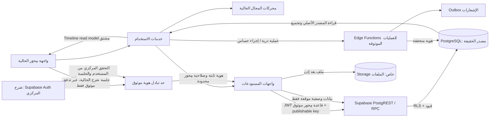
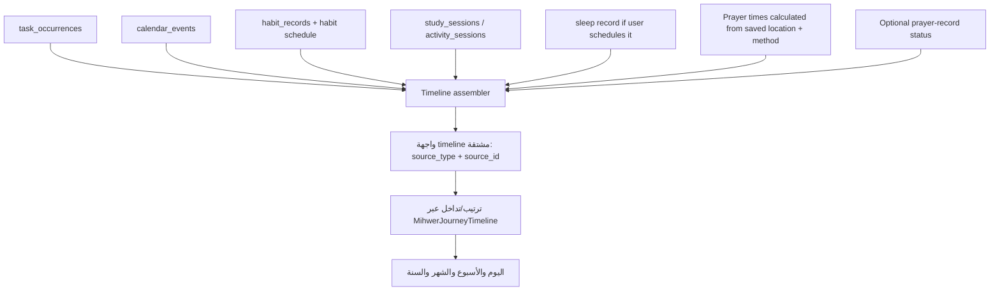

# معمارية النظام المستهدفة لمِحوَر

## المقصد والحدود

تحافظ المعمارية على واجهة مِحوَر ومحركات النطاق الحالية، وتضيف طبقات حفظ وهوية ومزامنة تدريجياً. الترحيل الأولي وموائم API موجودان ككود غير مطبق؛ لا توجد حالياً قاعدة Supabase أو جلسة هوية أو واجهة متصلة للمستخدم. انظر [تقرير تقدم التنفيذ](./MIHWAR-IMPLEMENTATION-PROGRESS.md) للحالة والاختبارات؛ وجود التصميم أو scaffold لا يعني أن الوظائف تعمل.

**القرار المعتمد:** يحتفظ صَرح بمصدر الهوية والجلسة، وتبقى قاعدة بيانات مِحوَر منفصلة على Supabase. لا ينشئ مِحوَر مسار OTP أو كلمة مرور مستقلاً، ولا يعيد استخدام قاعدة المتجر. الفحص أثبت أن صَرح يستخدم Supabase Auth OTP، لكنه لم يجد عقد تبادل/اتحاد هوية بين المشروعين؛ لذلك لا يُفترض أن رمز صَرح صالح في قاعدة مِحوَر. لا يُدمج الحسابان بالبريد أو بمعرّف يرسله المتصفح. يوجد الآن ترحيل SQL وموائم API أوليان، لكن لم يُطبقا أو يربطا بالواجهة؛ لا يبدأ حفظ بيانات حقيقية حتى يُنفذ ويُختبر حد موثوق يثبت هوية صَرح ويصدر صلاحية محدودة تقبلها قاعدة مِحوَر وRLS.

## الطبقات ومسؤولياتها

| الطبقة | المسؤولية | ما لا تملكه |
|---|---|---|
| واجهة العرض الحالية | التنقل، البطاقات، الترجمة، إظهار حالات التحميل/الفشل/انقطاع الشبكة، وأدوات الوصول | قرار الملكية أو قواعد صلاحية الخادم أو SQL |
| خدمات الاستخدام | حالات مثل `CompleteTaskOccurrence` و`RecordHabitDay` و`RecordSubscriptionOccurrence`; التنسيق والتحقق ومعالجة التعارض وإظهار نتيجة الحفظ | DOM أو استدعاء `supabase.from()` مباشرة من المكونات |
| محركات النطاق | قواعد المهمة والعادة والتقدم والخط الزمني؛ تبقى دوال نقية | الشبكة أو قاعدة البيانات أو الهوية أو `localStorage` |
| واجهات المستودعات | عقود TypeScript للقراءة والكتابة والإصدارات والتقسيم إلى صفحات؛ يسهل استبدال المزود | تفاصيل PostgREST داخل وحدات الواجهة |
| موائم Supabase | استعلامات PostgREST/Storage بعميل يحمل صلاحية قاعدة مِحوَر صادرة بعد تحقق هوية صَرح | اعتبار رمز صَرح صالحاً تلقائياً في مشروع مِحوَر |
| حد الهوية الموثوق | تبادل جلسة صَرح الحالية مع تحقق issuer/subject/audience/الانتهاء/الإبطال، وربط الهوية بمعرّف مِحوَر ثابت | إنشاء OTP أو كلمة مرور ثانية، أو قبول هوية من المتصفح |
| Edge Functions / RPC | العمليات الذرية متعددة الصفوف، provisioning idempotent، التصدير/الحذف، والإجراءات ذات الأسرار | تجاوز RLS دون مسوغ أو قبول `owner_id` من الطلب |
| PostgreSQL + RLS | مصدر الحقيقة والقيود والعزل والفهارس والعلاقات | تخزين بيانات مكررة للمسار أو نتائج تقارير قابلة لإعادة الحساب |
| Storage خاص | كتل الملفات بعد التحقق، ومفاتيحها الوصفية | نصوص الملاحظات أو صور عامة افتراضياً |

## مخططات البيانات والتدفق

### حدود النطاقات ومصادر الحقيقة

### نموذج ملكية وعلاقات (مبسّط)

```mermaid
erDiagram
  MIHWAR_USERS ||--|| USER_PREFERENCES : owns
  MIHWAR_USERS ||--o{ SARH_IDENTITY_LINKS : maps
  MIHWAR_USERS ||--o{ JOURNEYS : owns
  JOURNEYS ||--o{ LOCATIONS : stores
  JOURNEYS ||--o{ PATHS : groups
  JOURNEYS ||--o{ STATIONS : contains
  JOURNEYS ||--o{ TASKS : scopes
  STATIONS o|--o{ TASKS : places
  TASKS ||--o{ TASK_OCCURRENCES : schedules
  TASKS ||--o{ TASK_SUBTASKS : breaks_down
  JOURNEYS ||--o{ HABITS : scopes
  HABITS ||--o{ HABIT_REVISIONS : versions
  HABITS ||--o{ HABIT_RECORDS : records
  JOURNEYS ||--o{ CALENDAR_EVENTS : owns
  MIHWAR_USERS ||--o{ GOALS : owns
  MIHWAR_USERS ||--o{ PROJECTS : owns
  PROJECTS ||--o{ PROJECT_MILESTONES : plans
  GOALS }o--o{ PROJECTS : goal_project_links
  GOALS }o--o{ TASKS : goal_task_links
  GOALS }o--o{ NOTES : note_goal_links
  TASKS }o--o{ NOTES : note_task_links
  PROJECTS }o--o{ NOTES : note_project_links
  JOURNEYS ||--o{ DAILY_REFLECTIONS : records
  JOURNEYS ||--o{ PRAYER_RECORDS : records
  JOURNEYS ||--o{ STUDY_COURSES : contains
  STUDY_COURSES ||--o{ STUDY_LESSONS : contains
  STUDY_LESSONS ||--o{ STUDY_SESSIONS : schedules
  JOURNEYS ||--o{ ACTIVITY_SESSIONS : records
  JOURNEYS ||--o{ SLEEP_RECORDS : records
  JOURNEYS ||--o{ MEAL_LOGS : records
  MIHWAR_USERS ||--o{ SHOPPING_LISTS : owns
  SHOPPING_LISTS ||--o{ SHOPPING_ITEMS : contains
  MIHWAR_USERS ||--o{ SUBSCRIPTIONS : owns
  SUBSCRIPTIONS ||--o{ SUBSCRIPTION_OCCURRENCES : schedules
  FINANCIAL_ACCOUNTS ||--o{ FINANCIAL_TRANSACTIONS : records
  MIHWAR_USERS ||--o{ BUDGETS : configures
  BUDGETS ||--o{ BUDGET_CATEGORY_LIMITS : limits
  FINANCE_CATEGORIES ||--o{ BUDGET_CATEGORY_LIMITS : categorizes
  SHOPPING_ITEMS o|--o| FINANCIAL_TRANSACTIONS : optional_actual_purchase
  SUBSCRIPTION_OCCURRENCES o|--o| FINANCIAL_TRANSACTIONS : optional_actual_payment
  MIHWAR_USERS ||--o{ NOTES : owns
  NOTES ||--o{ ATTACHMENT_LINKS : links
  ATTACHMENTS ||--o{ ATTACHMENT_LINKS : describes
  MIHWAR_USERS ||--o{ AUDIT_EVENTS : audits
```

`MIHWAR_USERS` و`SARH_IDENTITY_LINKS` تمثيلان منطقيان لملكية مِحوَر وربط الهوية، وليسا جدولين منفذين. لا يصبح claim مالكاً صالحاً إلا بعد التحقق والتوقيع/التحويل في حد الهوية. التعريف المقترح للقيود في [تصميم قاعدة البيانات](./MIHWAR-DATABASE-DESIGN.md).

### بناء خط زمني دون نسخ البيانات

المهمة تُقرأ من جدول المهام/وقوعها، والموعد من `calendar_events`، والعادة من تعريفها وسجل اليوم، والصلاة تُشتق من إعدادات الموقع وطريقة الحساب. لا تُكتب نسخة منها إلى جدول `timeline_items`. نتائج التحليلات تُحسب من المصادر الأصلية أو materialized views قابلة لإعادة البناء فقط.

## المجالات والحدود

1. **حساب المستخدم والتفضيلات:** هوية موثقة، إعداد لغة ومنطقة زمنية وموضع صلاة اختياري، وسياسة الاحتفاظ بالموقع. لا تخزن جلسة الدخول أو الأسرار ضمن جداول المنتج.
2. **الرحلة:** رحلة/مسار، محطات، أحداث مدنية ومراجعة اليوم. تخدم العرض لا إعادة تعريف بقية الأنظمة.
3. **المهام والمشاريع والأهداف:** تعريف مهمة، مواعيد تنفيذها، أجزاء فرعية، مشروع/مراحل وهدف وروابطهما.
4. **العادات:** تعريف وتغييرات مستقبلية فعالة وسجلات تاريخية مستقلة.
5. **الصلاة والعبادات:** مواقيت محسوبة محلياً؛ سجلات الإنجاز الاختيارية كيان مستقل وحساس، ولا تخزن المواقيت المحسوبة.
6. **الدراسة والصحة:** نطاقان يضافان لاحقاً، لا توجد حالياً بيانات من النظام الحالي يجب الحفاظ عليها كأنها موجودة.
7. **المعرفة والملفات:** ملاحظات/أفكار/روابط واضحة النوع، وملفات خاصة مع تنظيف متناسق؛ أفكار المسارات الحالية قوالب وليست Idea Vault.
8. **المال:** دفتر معاملات موحد للدخل/المصروف والتحويل، وحدود ميزانية منفصلة؛ قائمة الشراء نية غير مالية، والاشتراك التزام ودورات متوقعة لا تنشئ مصروفاً حتى يسجل المستخدم دفعة فعلية.
9. **التقارير:** قراءات مشتقة؛ ليست مصدر حقيقة ولا تكتب التقدم إلى كيان ثان.
10. **الإشعارات:** قواعد المستخدم وoutbox وتسليم منفصلان عن توقيت المجال. الإشعارات تحتاج موافقة وإعداد عامل خلفي واختبارات تكرار/إلغاء.

## نمط زمن موحد والمحرك الفلكي

- لا يتغير `celestial.js` أو اختبارات JPL في نطاق هذا التصميم. محرك الشمس/القمر ومكتبة الصلاة يبقيان حساباً محلياً بالإصدارات المختبرة.
- `UserTimeContext = { instant, displayDate, displayTime, timeZone, locationId, latitude, longitude, prayerMethod, asrRule }` يحدد المدخلات بوضوح. `instant` هو مرجع الحساب للحظة، و`displayDate` هو تاريخ العرض؛ لا يستبدل أحدهما الآخر.
- تحتفظ الإعدادات بتفضيل IANA مثل `Asia/Baghdad` وإحداثيات اختيارية بإذن صريح. لا يكفي تخزين `UTC+3`؛ قواعد DST تتغير.
- تخزن المواعيد الفعلية كـ`timestamptz` مع `time_zone` للعرض/النية المدنية. التكرارات والعبادات اليومية تحتفظ بتاريخ محلي `date` ووقت جداري والمنطقة؛ يُحدّد سلوك الوقت المحلي المكرر/غير الموجود صراحةً ولا يُخمن.
- موضع الشخصية والإضاءة وموقع الأجرام بكسلياً مخرجات مشتقة فقط. لا تحفظ إحداثيات العرض أو المعاينة على الخادم.
- لا تنشئ طبقة الحساب الفلكي عداداً أو ساعة مستقلة. المعاينة تبقى مؤقتة، ولا تغير وقت الجهاز أو السجلات.
- **الإشعارات بالصلاة** ليست ضمن التحقق الحسابي الحالي؛ لا تنقل الحساب إلى Edge Function إلا بعد مقارنة توافق إصدار المكتبة والنتائج مع اختبار التكامل الحالي.

## نشر وبيئات

- بيئات منفصلة: تطوير، اختبار/قبول، إنتاج؛ لكل واحدة مشروع Supabase وVercel ونطاق ومفاتيح منفصلة. ترحيلات المخطط تمر بترتيب ثابت، ولا تُطبق يدوياً على الإنتاج.
- متغيرات عامة للمتصفح: عنوان Supabase ومفتاح publishable/anon فقط. الأسرار ومفتاح service role ومفاتيح موفري البريد/التنبيه تبقى في بيئة Edge/Vercel الخادمية.
- يجب ألا تتطلب الصفحة فتح `file://` في الإنتاج؛ تستخدم بناء Vercel مع CSP وHTTPS وheaders مناسبة.
- المنطقة المنطقية مشتركة (قاعدة واحدة لكل بيئة)، ويمكن فصل `public` لواجهة PostgREST عن مخطط/وظائف خاصة عند الحاجة. لا قاعدة لكل وحدة ولا جدول JSON عام.

## حدود التوسع

الإصدار الأول شخصي لكل مستخدم. لا تضف `journey_members` أو مشاركة عائلية/فريق قبل سياسة أدوار وعلاقات وRLS مختبرة. يمكن لاحقاً توسيع الهوية إلى مساحة/عضوية، مع بقاء `owner_id` الأصلية واضحة وعدم تحويل الحساب الشخصي بصمت إلى مساحة مشتركة.

## المراجع

- الجرد: [MIHWAR-PRODUCT-INVENTORY.md](./MIHWAR-PRODUCT-INVENTORY.md).
- قاعدة البيانات: [MIHWAR-DATABASE-DESIGN.md](./MIHWAR-DATABASE-DESIGN.md).
- الأمن: [MIHWAR-SECURITY-MODEL.md](./MIHWAR-SECURITY-MODEL.md).
- الخطة المرتبة: [MIHWAR-IMPLEMENTATION-ROADMAP.md](./MIHWAR-IMPLEMENTATION-ROADMAP.md).
