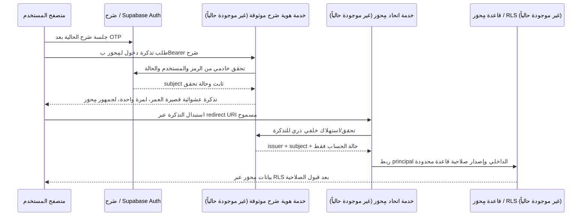

# عقد تكامل صَرح ومِحوَر

## الحالة

**القرار:** صَرح هو مصدر الهوية والجلسة؛ قاعدة بيانات مِحوَر مستقلة. لا ينفذ مِحوَر OTP أو كلمة مرور منفصلة، ولا يثق ببريد أو `user_id` يرسله المتصفح.

**التنفيذ الحالي:** لا يوجد تكامل دخول أو تبادل رموز بين المنتجين. هذه الوثيقة تسجل الأدلة والعقد المطلوب؛ أسماء العمليات أدناه مقترحة وليست endpoints موجودة. لا تُستخدم بيانات حساب حقيقية في مِحوَر قبل تنفيذ العقد واجتياز اختبارات العزل والانتهاء والإبطال.

**تحديث التنفيذ (20 نوفمبر 2026):** أضيف في مِحوَر ترحيل PostgreSQL أولي وموائم هوية صَرح مغلق افتراضياً (يرفض الطلب بـ503)، وطبقة API أولية، واختبارات وحدات محاكية واختبار pgTAP لم يُشغّل. لم يتغير حد التكامل المذكور أعلاه: لا يوجد عقد SSO من صَرح، ولا قاعدة Mihwar مطبقة، ولا رحلة دخول/مزامنة حقيقية. التفاصيل وحالة كل اعتماد موثقة في [تقرير تقدم التنفيذ](./MIHWAR-IMPLEMENTATION-PROGRESS.md) و[تقرير اكتمال Full Stack](./MIHWAR-FULLSTACK-COMPLETION-REPORT.md). هذا التحديث يحل محل العبارات التاريخية في بقية الوثيقة التي تفيد بعدم وجود migrations أو API، ولا يغيّر الأدلة السابقة الخاصة بغياب SSO.

## ما أثبته فحص الشيفرة

| المجال | الدليل الفعلي | الحد |
|---|---|---|
| تطبيق مِحوَر | `index.html` يشغل JavaScript محلياً؛ لا SDK لـSupabase أو API أو إعداد Vercel أو migrations داخل `Mihwer-Sarh/` | النموذج لا يستعيد جلسة صَرح ولا يحفظ سجلات المنتج في خادم |
| صفحة المنتج في صَرح | `products/mihwer.html` صفحة عرض/بيع ولها رابط من `index.html`؛ ليست نقطة تشغيل لتطبيق الرحلة | الانتقال إلى صفحة العرض لا يثبت دخولاً أو استمرارية جلسة |
| دخول حساب صَرح | `store-backend.js` يستخدم Supabase Auth SDK و`signInWithOtp` و`verifyOtp`، مع حفظ الجلسة بواسطة SDK، وواجهات `currentUser`, `signOut`, `onAuthStateChange` | هذا دخول حساب المتجر ضمن مشروع Supabase الخاص بصَرح، وليس اتحاد هوية لمِحوَر |
| تحقق Edge Function في صَرح | `supabase/functions/_shared/supabase.ts` يتحقق من المستخدم بواسطة `auth.getUser(accessToken)`؛ `store-account` يقرأ بيانات الحساب باستعمال UID المتحقق منه | لا توجد وظيفة لإصدار تذكرة لمِحوَر أو تحقق audience خاص به |
| قاعدة صَرح الحالية | ترحيلات `supabase/migrations/` المنشورة في مساحة العمل تتعلق بملفات `profiles`, `store_*`, الاسترداد والتفعيل؛ حساب الملف مربوط بـ`auth.users.id` في مشروع المتجر | لا توجد قاعدة أو migration لمِحوَر هنا؛ لا يجوز مشاركة جداول المتجر أو صلاحية مديره |
| اختبار هوية صَرح | `supabase/tests/auth-sdk.integration.test.ts` يغطي OTP وتجديد الجلسة والخروج وRLS لحساب صَرح | وجود الاختبار لا يثبت نجاح تشغيله في هذه الجولة، ولا يختبر دخول مِحوَر |

### التناقض مع تقارير خط الأساس الأقدم

`quality-evidence/CURRENT-MIHWER-BASELINE.md` مؤرخ في 18 نوفمبر 2026 ويصف خمس اختبارات و46 نجاحاً ولا يستخدم `localStorage`. المصدر الحالي يحتوي 14 ملف اختبار، ويشمل 105 اختبارات ناجحة؛ كما أن `paths-lab.js` يحفظ حصاد اليوم محلياً تحت `mihwer.dailyReflections`. لذلك يُعامل تقرير خط الأساس كسجل تاريخي لا كحقيقة راهنة. لا يعني التخزين المحلي مزامنة أو حماية أو نسخة احتياطية.

## تدفق الهوية المطلوب

هذا رسم هدف وليس تدفقاً منفذاً. قاعدة Supabase منفصلة لا تقبل JWT صَرح تلقائياً؛ لا بد من إعداد اتحادي موثق يجعل قاعدة مِحوَر تثق بهوية متحققة وclaim مالك ثابت. إذا لم يدعم إعداد Supabase ذلك بأمان، يستخدم المنتج API موثوقاً يحافظ على RLS/هوية المالك؛ لا يُستعاض عنه بمفتاح `service_role` في المتصفح.

## العقد المقترح للتنفيذ

المقترح التالي عقد جديد يحتاج اعتماده وتنفيذه في المشروعين. لا توجد المسارات حالياً.

### 1. طلب التذكرة في صَرح

- عملية من صَرح تتطلب جلسة موجودة، وتتحقق من Bearer token على الخادم عبر Auth المعتمد في صَرح.
- تثبت هوية المستخدم من `sub`/UID الذي أعاده التحقق الخادمي، لا من body ولا query.
- تتحقق من حالة الحساب باستخدام مصدر صلاحيات صَرح الفعلي. الفحص الحالي لم يجد سياسة قفل/إيقاف مخصصة يمكن نقلها إلى مِحوَر؛ يجب تحديدها قبل إطلاق التكامل.
- تنشئ تذكرة عشوائية عالية العشوائية، مخزنة في صَرح بصيغة hash، مرتبطة بجمهور URI مِحوَر المسموح، صالحة لثوانٍ قليلة، وتُستهلك مرة واحدة بمعاملة ذرية. لا تحتوي التذكرة بريداً أو رمز صَرح.
- لا تسجل التذكرة أو أي رمز في logs. لا يسمح redirect حر؛ قائمة redirect URI ثابتة.

### 2. استبدال التذكرة في مِحوَر

- يستقبلها endpoint خادمي فقط، عبر تدفق callback مضبوط مع `state`/nonce. لا توضع رموز الجلسات في query string أو سجلات URL؛ تستخدم آلية callback لا تسربها إلى موارد الطرف الثالث أو Referer.
- يتحقق من الاستخدام الواحد والجمهور والانتهاء و`state`/nonce، ويطلب من خدمة صَرح نتيجة تحقق خلفية محمية بعقد خدمة-إلى-خدمة. لا يقبل UID مرسلاً من المتصفح.
- ينشئ أو يستعيد `mihwer_users` بصورة idempotent مع قيد تفرد على `(issuer,subject)` في `sarh_identity_links`. لا ينسخ البريد أو صورة الحساب إلا إذا أتاحتها واجهة موثقة وبالحد اللازم.
- يصدر صلاحية خاصة بقاعدة مِحوَر قصيرة العمر من موائم يدعمه إعداد Supabase الخاص بها. يجب اختبار قبول التوقيع و`iss` و`aud` و`sub` ووقت الانتهاء عند PostgREST/RLS قبل توصيل الواجهة. لا يمكن ادعاء أن هذا متاح في الإعداد الحالي.
- كل جداول المستخدمين وسياسات Storage تقيد الوصول إلى principal الداخلي المتحقق. لا صلاحية متجر إدارية تعبر إلى مِحوَر.

### 3. الجلسة والخروج والإبطال

- مِحوَر لا يعيد تنفيذ OTP، ولا يخزن رمز صَرح الطويل في بيانات المنتج، ولا يعلن أن حفظاً نجح قبل إقرار API.
- ينتهي رمز قاعدة مِحوَر بسرعة؛ التحديث يتطلب تحققاً جديداً من جلسة صَرح. يجب حسم مدة الرمز وسياسة refresh/revocation مع مالكي المشروعين.
- عند انتهاء/إبطال جلسة صَرح أو تعطيل الحساب، يرفض حد الهوية إصدار تذكرة أو صلاحية جديدة. لا توجد حالياً قناة إبطال آنية بين المشروعين؛ يلزم إبطال قصير المدى مثبت أو endpoint إعادة تحقق للعمليات الحساسة قبل الإنتاج.
- الخروج ينهي جلسة صَرح حسب سلوك المنتج، ويمسح جلسة مِحوَر التابعة في الوقت نفسه. لا تُنشأ جلسة مستقلة يمكنها البقاء بعد خروج صَرح.
- يحذف سجل الربط أو يعطل فقط عبر سير عمل حذف/إلغاء ربط مصرح ومدقق؛ لا يحذف بيانات المستخدم أو مشروع الإنتاج تلقائياً عند تسجيل الخروج.

## حدود البيانات والصلاحيات

- المصدر المركزي يظل مالك بيانات الدخول ووسائل التحقق وبيانات الملف الشخصي.
- قاعدة مِحوَر تحتفظ بسجلات تنظيم اليوم فقط، مع principal داخلي وربط issuer/subject بأقل قدر لازم.
- لا تُنسخ كلمات مرور أو OTP أو refresh tokens إلى قاعدة مِحوَر. لا يُستخدم البريد كمفتاح دمج.
- لا يقرأ صَرح مهام أو صلاة أو صحة أو أموال مِحوَر افتراضياً. لا تصلح صلاحية admin في متجر صَرح لفتح هذه البيانات.
- كل إنشاء أولي لحساب مِحوَر يتم من حد موثوق وبـupsert محكوم بالتفرد. لا يوجد حالياً إنشاء principal في قاعدة مِحوَر.
- الواجهة لا تحمل `service_role`, مفاتيح توقيع، سر استبدال، أو اتصال قاعدة بيانات.
- لا تكتب محاولات الربط نصوص رموز/تذاكر/بريد/موقع/سجل حساس في السجل. سجّل request ID وحالة عامة فقط.

## الأخطاء المتوقعة

| الحالة | السلوك المطلوب |
|---|---|
| رمز صَرح منتهي أو غير صالح | `401` عام، لا إنشاء principal ولا إرجاع بيانات |
| جمهور/issuer غير صحيح | `401`، لا قبول قيمة يرسلها العميل كإعداد |
| تذكرة منتهية أو مستهلكة أو معاد تشغيلها | رفض دون أثر جانبي؛ لا إنشاء مستخدم مكرر |
| مستخدم موقوف وفق مصدر صَرح | رفض موحد دون إصدار صلاحية مِحوَر |
| قاعدة مِحوَر أو خدمة الهوية غير متاحة | رسالة قابلة لإعادة المحاولة؛ لا حالة نجاح ولا تخزين محلي يوهم بالنجاح |
| جلسة صَرح انتهت أثناء الكتابة | رفض الطلب، إعادة تحقق/دخول صَرح، ثم إعادة محاولة idempotent فقط |
| تضارب owner أو version | رفض صريح؛ لا قبول `owner_id` من الطلب ولا last-write-wins |

## إعدادات مطلوبة (أسماء منطقية لا متغيرات موجودة)

لا توجد حالياً ملفات بيئة أو إعدادات تشغيل لمِحوَر. قبل الاختبار المتكامل يحتاج مالكو الحساب إلى توفيرها عبر مخزن أسرار المنصة، لا عبر Git أو المحادثة:

1. مشروع Supabase مستقل لمِحوَر وبيئة تطوير/اختبار، مع URL ومفتاح publishable ومفاتيح خادم مخزنة في Edge/Vercel.
2. نطاق نشر مِحوَر المعتمد وredirect URI ثابت، ونطاقات CORS/redirect لـصَرح.
3. عقد issuer/subject/audience، مفاتيح التحقق/التدوير أو endpoint خادمي معتمد، عمر التذكرة، وآلية الإبطال.
4. آلية تحقق خدمة-إلى-خدمة؛ أي سر مشترك يولّد ويخزن خارج المستودع من مالكي البيئة، ولا يرسل في المحادثة.
5. قرار تقني مثبت لكيفية قبول قاعدة Supabase المنفصلة صلاحية مرتبطة بهوية صَرح، وكيف تصل الهوية الموثقة إلى RLS. لا يثبت وجود مفتاح `SUPABASE_JWT_SECRET` في إعداد Mihwar.
6. سياسة تعطيل الحساب، والخروج، ومدة الجلسة، وسياسة الاحتفاظ/الحذف والتصدير ونسخ Storage.

## نتائج الاختبارات

| الاختبار | النتيجة في هذه المهمة |
|---|---|
| Mihwer Unit/regression suite | **105/105 ناجحة، 0 فشل، 0 تخطي**؛ `cd Mihwer-Sarh && node --test *.test.cjs` |
| فحص صياغة ملفات Mihwer JavaScript الجذرية | **نجاح**؛ `node --check` لكل `*.js` في المجلد |
| اختبار Sarh OTP/RLS الموجود | يوجد ملف اختبار `supabase/tests/auth-sdk.integration.test.ts`، لكن لم يُشغّل في هذه الجولة لغياب daemon لـDocker والبيئة المحلية المطلوبة |
| تبادل هوية صَرح→مِحوَر / رمز منتهي أو مزور / replay | **غير منفذ، لا يوجد endpoint أو إعداد مشروع Mihwer** |
| RLS لبيانات مِحوَر / عزل مستخدمين / Storage | **غير منفذ؛ لا توجد قاعدة/جداول Mihwer** |
| تكامل متصفح/تطبيق من دخول صَرح إلى بيانات مِحوَر | **غير منفذ؛ تطبيق Mihwer لا يتصل بخدمة** |

## القيود

- `supabase status` لم يستطع الاتصال بـDocker daemon؛ لم تُشغل migrations أو اختبارات PostgreSQL محلية.
- لا توجد في بيئة التنفيذ متغيرات `SUPABASE_*`/`SARH_*`/`MIHWAR_*` أو ملفات `.env` ضمن المشروع، ولا يوجد إعداد Vercel.
- المجلدان لا يحتويان مستودع Git؛ لا يمكن ربط تغييرات بهذه المهمة بـcommit أو إخراج diff موثوق.
- لا يمكن إثبات سلوك تعطيل حساب صَرح أو تدوير/إبطال الهوية على مستوى النظام من اختبار الكود الحالي.
- هذا العقد لا يعلن تكاملاً جاهزاً؛ هو مواصفة تنفيذ آمنة مبنية على ما أمكن إثباته.
